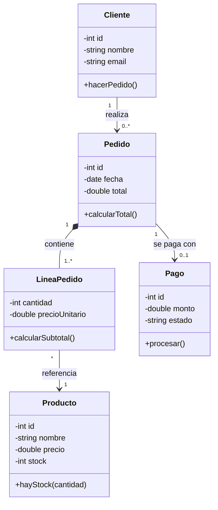
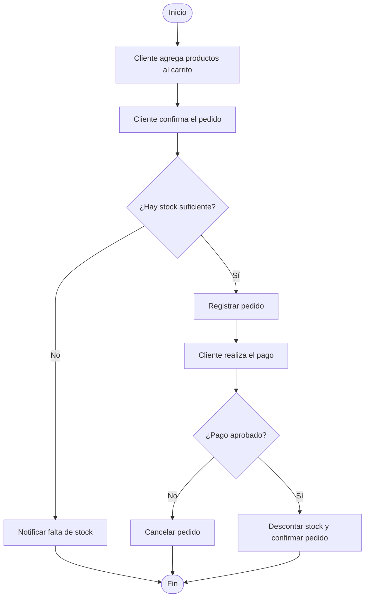

# Modelo de Dominio: Tienda en Línea

## Entidades
- **Cliente:** persona que compra.
- **Producto:** artículo que se vende (nombre, precio, stock).
- **Pedido:** compra realizada por un cliente.
- **LineaPedido:** un producto dentro de un pedido, con su cantidad.
- **Pago:** cobro asociado a un pedido.

## Relaciones
- Un Cliente realiza muchos Pedidos.
- Un Pedido contiene una o más LineasPedido.
- Cada LineaPedido referencia un Producto.
- Un Pedido se paga con un Pago.

## Reglas de negocio
- Un pedido solo se paga si hay stock suficiente.
- La cantidad de cada línea debe ser mayor que 0.
- El total del pedido es la suma de (precio unitario × cantidad) de sus líneas.
- Al aprobarse el pago, se descuenta el stock.

## Diagrama de clases

## Diagrama de actividades (proceso de compra)

